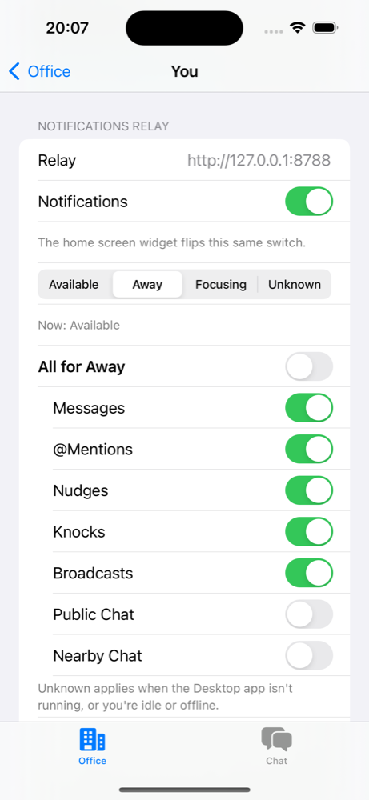
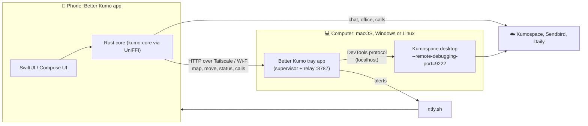

<div align="center">


# Better Kumo

**Your [Kumospace](https://www.kumospace.com) office in your pocket.**<br>
Native iPhone and Android apps plus a small tray app for macOS, Windows and Linux that lets the phone see and
control the avatar on your desktop, and sends you the office's notifications.

[Download](https://github.com/IgorKravtsov/better-kumo-app/releases/latest) · [Install](#install) · [Features](#features) · [How it works](#how-it-works) · [Full install guide](docs/install.md) · [Development](#development)

</div>

<p align="center">
  
  &nbsp;
  
  &nbsp;
  
</p>

> Screenshots use a demo relay with made-up people (`cargo run -p kumo-relay --example demo_relay`).

## Features

| | Phone app alone | + Better Kumo on your computer |
|---|:---:|:---:|
| Chat: DMs, groups, channels, threads, reactions, photos, GIFs, Markdown | ✅ | ✅ |
| Office: rooms, people, statuses, search | ✅ | ✅ |
| Calls in a room (audio and video) | ✅ | ✅ |
| **Desktop screen**: live floor map; move, change rooms and floors, follow people, set status, mic/camera, nudge | | ✅ |
| Take the desktop's call on the phone and hand it back | | ✅ |
| Notifications: messages, @mentions, nudges, knocks, broadcasts, Public Chat, Nearby Chat, someone joining your floor | Android (from its own connection) | ✅ iPhone and Android, via ntfy |
| Separate notification switches for Available / Away / Focusing / Unknown | Android | ✅ |
| Home screen widget: notifications on/off in one tap | Android | ✅ |

## Install

You need three things. The [full install guide](docs/install.md) explains every step, with options and fixes.

**1. On the computer where Kumospace runs: the Better Kumo tray app.**

Make sure Kumospace desktop is installed and signed in, then download Better Kumo for your system from the
**[latest release](https://github.com/IgorKravtsov/better-kumo-app/releases/latest)**:

| macOS 13+ (Apple Silicon and Intel) | Windows 10/11 (x64) | Linux (x64) |
|---|---|---|
| `brew install --cask igorkravtsov/tap/better-kumo`<br><br>or download `Better-Kumo-macOS-<version>.zip`, move `Better Kumo.app` to `/Applications` and, the first time, right-click → **Open** (not notarized). | Download `Better-Kumo-Windows-x64-<version>.zip`, unzip to a folder that stays and run `Better Kumo.exe`. If SmartScreen warns: **More info** → **Run anyway**. Allow the firewall prompt for private networks. | Ubuntu/Debian: add the [APT repository](docs/install.md#61-install-better-kumo) and `sudo apt install better-kumo`, or install the `.deb` from the release.<br><br>Other distributions: `Better-Kumo-Linux-x64-<version>.tar.gz`. A desktop with a system tray is needed. |

The [install guide](docs/install.md#61-install-better-kumo) has step-by-step details for each system and how to
build it yourself. Better Kumo then:
- restarts Kumospace with phone control on;
- signs itself in from it;
- starts the relay the phone talks to.

Turn on **Start at login** in its menu.

**2. On your phone: the Better Kumo app.**

| iPhone (any Apple ID, even free) | Android 8+ |
|---|---|
| `scripts/build-ios-device.sh --team <TEAM_ID>` with the iPhone connected by cable. Apple doesn't allow installing iPhone apps from a downloaded file. | Download `Better-Kumo-Android-<version>.apk` from the **[latest release](https://github.com/IgorKravtsov/better-kumo-app/releases/latest)** on the phone and open it; allow installing from your browser when asked. Updates install over the old version. Or build it: `scripts/build-android-release.sh --install`. |

Sign in with **Sign in with browser**, or with a sign-in link from a computer that is already signed in.


**3. Connect them.**

1. Install [Tailscale](https://tailscale.com) on the computer and the phone, so the phone can reach the computer from
   anywhere.
2. In the Better Kumo menu, choose **Pair a phone…**.
3. Scan the code. On iPhone, use **Profile → Scan relay QR code**. On Android, use the camera app.


**Notifications on iPhone** arrive through [ntfy](https://ntfy.sh):
1. In **Profile → Notifications relay**, type a topic (any hard-to-guess name) and tap **Save**.
2. Subscribe to the same topic in the ntfy app.

Android shows notifications itself by default (**This phone**). Switch to ntfy in the same place if you prefer it.

## How it works



- **The phone app talks to Kumospace directly** for chat, the office and calls. All logic lives in a shared Rust core.
  Swift and Kotlin only draw it.
- **Better Kumo on the computer** starts Kumospace desktop with a local debugging port and reads it. It sees what the
  desktop sees: floors, rooms, people, nudges, knocks, broadcasts and Public/Nearby Chat. It runs a small **relay**
  (HTTP on port 8787) that the phone pairs with by QR code.
- **Notifications** come from the relay, filtered by your current status and your switches. iPhones get them through
  ntfy. Android can show them itself.

More: [architecture](docs/architecture.md) · [design decisions](docs/adr) · [glossary](GLOSSARY.md).

## Repository

| Path | What |
|---|---|
| [`apps/ios`](apps/ios) | iPhone app and widget (SwiftUI, XcodeGen) |
| [`apps/android`](apps/android) | Android app and widget (Jetpack Compose) |
| [`core`](core) | Rust workspace: `kumo-core` (protocol, chat, office, calls), `kumo-ffi` (UniFFI bindings), `kumo-relay` (relay and desktop bridge), `kumo-desktop` (Better Kumo tray app), `kumo-devtools`, `kumo-cli` |
| [`scripts`](scripts) | build and install scripts |
| [`docs`](docs) | [install guide](docs/install.md), [architecture](docs/architecture.md), [Kumospace API](docs/kumospace-api.md), [Sendbird protocol](docs/sendbird-protocol.md), [roadmap](docs/roadmap.md) |
| [`apps/watcher`](apps/watcher) | the first Node prototype; replaced by the relay, kept for reference |

## Development

Prerequisites (full list in the [install guide](docs/install.md#2-build-machine-one-time)):
- Rust with the iOS and Android targets;
- Xcode and `xcodegen`;
- the Android SDK and NDK, plus `cargo-ndk`;
- JDK 17.

```sh
cd core && cargo test                                  # the whole core: protocol, chat, relay, calls
cargo run -p kumo-cli -- --help                        # the core from a terminal: login, channels, tail-chat …
cargo run -p kumo-relay --example demo_relay           # a relay with a made-up office, for UI work and screenshots

scripts/build-core-ios.sh && (cd apps/ios && xcodegen generate && open Kumowatch.xcodeproj)
scripts/build-core-android.sh && (cd apps/android && ./gradlew :app:installDebug)
```

Re-run the `build-core-*` script after changing Rust code; `PROFILE=debug` builds faster.
Checks before a PR:

```sh
cd core && cargo fmt --all --check && cargo clippy --workspace --all-targets -- -D warnings && cargo test --workspace
```

**Releasing:** bump `version` in `core/Cargo.toml` and the `versionName` default in
`apps/android/app/build.gradle.kts`, then push a tag:

```sh
git tag v0.2.0 && git push origin v0.2.0
```

The [Release workflow](.github/workflows/release.yml) builds Better Kumo for macOS (universal), Windows and Linux,
and the signed Android APK, and publishes them as a GitHub Release. It also publishes the `.deb` to the APT repository on GitHub Pages and updates
the cask in [IgorKravtsov/homebrew-tap](https://github.com/IgorKravtsov/homebrew-tap). Repository secrets:
`ANDROID_KEYSTORE_B64` and `ANDROID_KEY_PASSWORD` (APK signing), `APT_GPG_PRIVATE_KEY` (APT signing),
`TAP_DEPLOY_KEY` (write access to the tap).

The [`kumospace-devtools`](.claude/skills/kumospace-devtools/SKILL.md) skill shows how to watch what the Kumospace
desktop app sends and receives.

## License

[MIT](LICENSE) © 2026 Igor Kravtsov

> **Note:** Better Kumo is an independent project and is not affiliated with Kumospace. The debugging port gives
> local programs on that computer full access to your Kumospace session; it is not reachable from the network.
