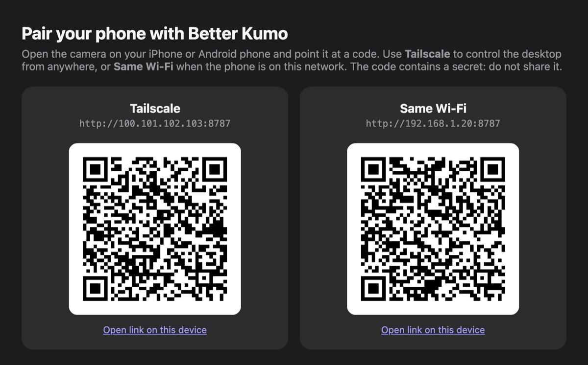
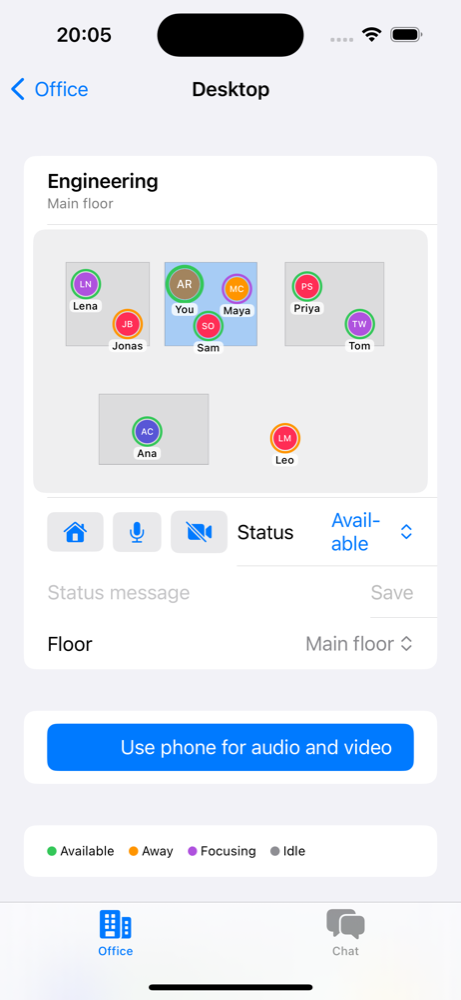
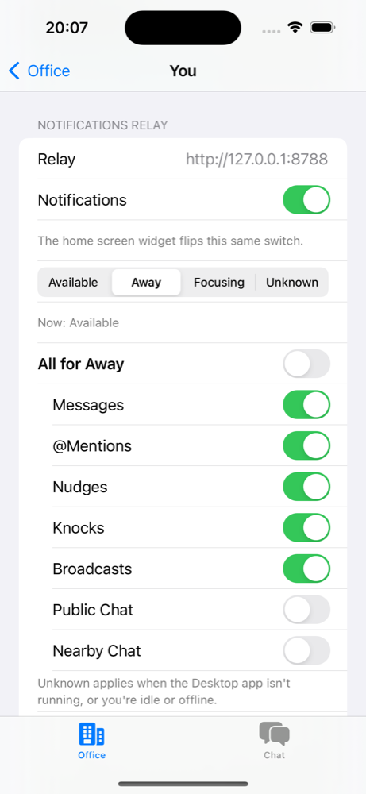
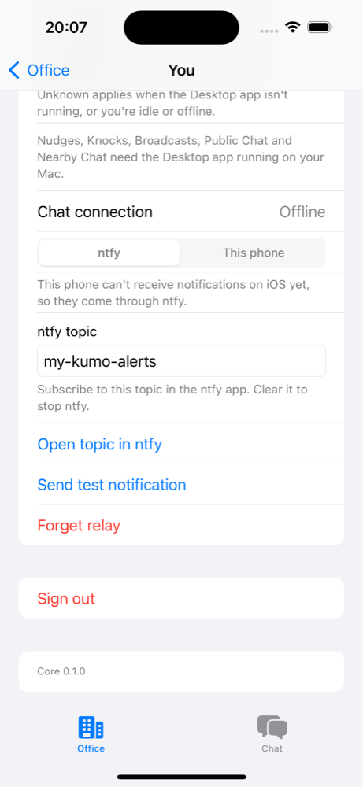

# Installing Better Kumo

The apps are called **Better Kumo** on phones and on the Mac. Bundle IDs, package names and the Rust crates keep the
internal name *kumowatch*. This guide covers every piece end to end: building, installing the apps on real phones, and setting up the Mac that
runs Kumospace desktop. The sections are written so you can follow them top to bottom on a clean machine.

## 1. What runs where

```
 Phone (Android / iPhone)                Mac with Kumospace desktop ("office Mac")
 ┌──────────────────────────┐            ┌─────────────────────────────────────────────┐
 │ Better Kumo app          │            │ Kumospace.app  --remote-debugging-port=9222 │
 │  · chat, office, calls   │──Kumospace─┤        ▲ DevTools (localhost only)          │
 │    (talks to Kumospace,  │  cloud     │        │                                    │
 │     Sendbird, Daily      │            │ Better Kumo menu bar app                    │
 │     directly)            │            │  · starts and watches Kumospace             │
 │  · Desktop screen  ──────┼──HTTP──────┤  · relay on port 8787: map, move, status,   │
 │  · notifications         │ (Tailscale │    mic/camera, calls, notifications         │
 └──────────────────────────┘  or LAN)   └─────────────────────────────────────────────┘
```

- **The app alone** gives you chat, the office, people and calls. It needs no Mac.
- **Better Kumo on the office Mac** adds two things:
  - **The *Desktop* screen**, which shows and controls the avatar of the desktop app.
  - **Notifications** for messages, @mentions, nudges, knocks, broadcasts, Public Chat, Nearby Chat and people joining your floor. You choose
    which ones for each of your statuses (§7).
- **Android** shows notifications itself by default (*This phone*), or through ntfy.
- **iPhone** gets them through ntfy (free), or through APNs with a paid Apple Developer account.
- The phone reaches the Mac over the same Wi-Fi or, better, over **Tailscale**, which works from anywhere.

| Piece | Where | Needed for |
|---|---|---|
| Android app | Android phone, 8.0+, arm64 | everything on Android |
| iOS app | iPhone, iOS 17+ | everything on iPhone |
| Kumospace desktop | office Mac | everything that Better Kumo adds |
| Better Kumo menu bar app (includes the relay) | office Mac | Desktop screen, notifications from the office |
| Tailscale | office Mac + phones | reaching the relay away from the office Wi-Fi |
| ntfy app | iPhone | iPhone notifications without a paid Apple account |

The build machine and the office Mac can be the same Mac or two different ones.

## 2. Build machine (one-time)

You need a Mac with Apple Silicon for iOS. Android-only builds also work on Linux.

```sh
# Xcode from the App Store, then:
xcode-select --install
brew install xcodegen openjdk@17 android-commandlinetools   # or install Android Studio instead
brew install --cask android-platform-tools                   # adb

# Rust
curl --proto '=https' --tlsv1.2 -sSf https://sh.rustup.rs | sh
rustup target add aarch64-apple-ios aarch64-apple-ios-sim aarch64-linux-android armv7-linux-androideabi x86_64-linux-android
cargo install cargo-ndk

```

Install the Android SDK with Android Studio → Settings → Languages & Frameworks → Android SDK:
- SDK Platform **API 37**;
- Build-Tools **36.1+**;
- **NDK (Side by side)** 27.x. The build scripts pick the newest NDK they find.

- Gradle finds the SDK through `ANDROID_HOME`, which defaults to `~/Library/Android/sdk`.
- Or put `sdk.dir=/path/to/sdk` into `apps/android/local.properties`.
- Use JDK 17: `export JAVA_HOME=$(/usr/libexec/java_home -v 17)`.

Check the core:

```sh
cd core && cargo test
```

## 3. Android phone

### 3.0 Download instead of building

The **[latest release](https://github.com/IgorKravtsov/better-kumo-app/releases/latest)** has a signed
`Better-Kumo-Android-<version>.apk`. Open the release page on the phone, download the APK, tap it and allow installs
from the browser when Android asks. Then continue with §3.3. Build it yourself (below) only if you want your own
signing key.

### 3.1 Build the APK

```sh
scripts/build-android-release.sh
```

- **First run.** Creates a signing key in `~/.config/kumowatch/`: `android-release.jks` and
  `android-signing.properties`.
  - **Back up both files** (for example to a password manager).
  - Every update must be signed with the same key. Without it you have to uninstall the app, which loses the sign-in
    and settings, before a new build installs.
- **Output.** `dist/kumowatch-<version>-<build>.apk`, plus a copy at `dist/kumowatch-latest.apk`.
- **Architecture.** arm64 only, which covers every modern phone. Use `ABIS="arm64-v8a armeabi-v7a"` for an old
  32-bit phone.
- **Rebuilding.** `--skip-core` rebuilds the APK without recompiling Rust when only Kotlin changed.

The release app is `com.kravtsov.kumowatch` and is called "Better Kumo". Development builds
(`./gradlew :app:installDebug`) are `com.kravtsov.kumowatch.debug` and are called "Better Kumo Dev". Both can sit on the
same phone.

### 3.2 Install it

**Option A — USB cable** (fastest; also for updates):

1. On the phone, open Settings → About phone and tap *Build number* 7 times to turn on Developer options.
2. Settings → System → Developer options → *USB debugging*: on.
3. Connect the cable and accept the "Allow USB debugging?" prompt on the phone.
4. Run:

   ```sh
   adb devices                                  # the phone must show as "device"
   scripts/build-android-release.sh --install   # builds and installs on every connected device
   # or, for an existing APK:
   adb install -r dist/kumowatch-latest.apk
   ```

**Option B — Wireless adb** (Android 11+, phone and Mac on the same Wi-Fi):

1. Developer options → *Wireless debugging* → *Pair device with pairing code*.
2. Pair, using the address shown in the pairing dialog:

   ```sh
   adb pair <ip>:<pair-port>            # enter the 6-digit code
   ```

3. Connect, using the address on the Wireless debugging screen:

   ```sh
   adb connect <ip>:<port>
   adb install -r dist/kumowatch-latest.apk
   ```

**Option C — Send the file** (no developer options at all):

1. Send `dist/kumowatch-latest.apk` to the phone: Telegram "Saved messages", Google Drive, AirDrop-like apps,
   or a USB file copy.
2. Tap the file on the phone.
3. Android asks to allow installs from that app (Files, Telegram, …): allow it.
4. Google Play Protect may warn "unknown developer": choose *More details → Install anyway*.
5. To update later, install a newer APK the same way. Data is kept.

### 3.3 First launch on Android

1. Allow **notifications** when asked. They are needed for chat alerts and the relay.
2. Sign in (see §5).
3. For calls, allow **microphone** and **camera** on first use.
4. Turn off battery optimization so mirroring survives in the background: Settings → Apps → Better Kumo → Battery →
   *Unrestricted*. On Samsung, Xiaomi and similar phones, also see dontkillmyapp.com.
5. Add the **widget**: long-press the home screen → Widgets → Better Kumo.
   - Tapping it turns notifications on or off, for the delivery you chose (§7).
   - With *This phone* delivery and notifications on, a persistent "Kumospace alerts" notification shows that the
     app keeps its connection open.
6. Pair the phone with Better Kumo on the Mac (§6.3).

## 4. iPhone

There is no "APK" for iOS. Apple only runs apps that are signed for your device. The app is built on a Mac and
installed with Xcode tools.

### 4.1 Pick an Apple account

| | Free Apple ID ("Personal Team") | Paid Apple Developer Program ($99/year) |
|---|---|---|
| Install on your own iPhone | yes | yes |
| App keeps working | **7 days**, then rebuild and reinstall | 1 year; TestFlight builds 90 days |
| Push notifications (APNs) | no; use ntfy (§7.3) | yes |
| Home-screen widget | yes | yes |
| Share with other people | no (must be their Apple ID) | TestFlight, up to 10,000 testers |
| Install without a cable, updates over the air | no | TestFlight (§4.4) |

Everything else works the same on both: chat, office, calls, the Desktop screen, the widget and ntfy notifications.

### 4.2 One-time setup

1. Xcode → Settings → Accounts → **+** → Apple ID → sign in.
2. Note the **Team ID**. Xcode → Settings → Accounts → select the team → the ID is shown in brackets. It can also be
   found with:

   ```sh
   defaults read com.apple.dt.Xcode IDEProvisioningTeamByIdentifier | grep -E 'teamID|teamName|isFree'
   ```

3. Connect the iPhone by cable, unlock it and tap *Trust This Computer*.
4. On the iPhone, turn on Settings → Privacy & Security → **Developer Mode**. The phone restarts; confirm.
   The switch appears only after the phone has been connected to Xcode once. If you don't see it, open
   Xcode → Window → Devices and Simulators with the phone connected.
5. After the first pairing, the phone can be reached over Wi-Fi as well: Devices and Simulators →
   *Connect via network*.

### 4.3 Build and install

```sh
scripts/build-ios-device.sh --team <TEAM_ID>                 # free or paid team, base features
scripts/build-ios-device.sh --team <TEAM_ID> --full          # paid team: + Apple push notifications
```

The script:

1. builds the Rust core for iOS;
2. generates the Xcode project;
3. signs with automatic provisioning, which registers the device and the app IDs;
4. installs on the connected iPhone and starts the app.

Options:

- `--device <name|udid>` — choose the phone when several are connected (`xcrun devicectl list devices`).
- `--bundle-id <id>` — use a different bundle ID. This is needed if Apple says `com.kravtsov.kumowatch` is taken by
  another team. The widget and its shared keychain group follow it automatically.
- `--skip-core` — skip the Rust build when only Swift changed.
- `KUMO_TEAM=<TEAM_ID>` in the environment works instead of `--team`.

The first time a **free** team installs an app, iOS refuses to open it as an "Untrusted Developer". Fix it on the
iPhone: Settings → General → VPN & Device Management → your Apple ID → *Trust*.

**Free team, every 7 days:** re-run `scripts/build-ios-device.sh --team <TEAM_ID> --skip-core` with the phone
connected. Sign-in and data are kept.

**From Xcode instead of the script:**

1. Run:

   ```sh
   scripts/build-core-ios.sh
   cd apps/ios && xcodegen generate && open Kumowatch.xcodeproj
   ```

2. Select the *Kumowatch* target → Signing & Capabilities → choose your team. Do the same for the *KumowatchWidget*
   target.
3. Pick your iPhone as the run destination and press ⌘R.

`xcodegen generate` resets the team, so the script is the more convenient path.

### 4.4 TestFlight (paid team)

TestFlight is the easiest way to keep the app on your iPhones. No cable and no Developer Mode are needed. A build
works for 90 days, and new builds arrive as updates in the TestFlight app.

The team must be **your own** Apple Developer Program membership. Enroll at developer.apple.com/programs
($99/year, approval takes from a few hours to two days).

One-time setup:

1. **Register the App ID.** developer.apple.com → Certificates, IDs & Profiles → Identifiers → **+** → App IDs → App.
   - Bundle ID `com.kravtsov.kumowatch`.
   - Enable *Push Notifications*.
   - Repeat for `com.kravtsov.kumowatch.widget` (no extra capabilities).
   - The app and the widget share the relay settings through a keychain group (`<TEAM ID>.<bundle id>.shared`),
     which needs no registration.
   - The script can register these automatically, but doing it by hand avoids surprises.
2. **Create the app record.** App Store Connect (appstoreconnect.apple.com) → Apps → **+** → New App.
   - Platform iOS; bundle ID as above; SKU `kumowatch`.
   - Name: the store name must be unique across the App Store and must not look like someone else's trademark.
     If "Better Kumo" is taken, use another record name. The name under the icon stays "Better Kumo": it comes
     from the build, not from the record.
3. **Create an API key for uploads.** App Store Connect → Users and Access → Integrations → App Store Connect API
   → Team Keys → **+**, role *App Manager*.
   - Download `AuthKey_<KEYID>.p8`; it can be downloaded only once.
   - Note the *Issuer ID* shown above the key list.
4. **Write the local config.** Save the key as `~/.config/kumowatch/AuthKey_<KEYID>.p8` and create
   `~/.config/kumowatch/testflight.env`:

   ```sh
   KUMO_TEAM=<YOUR TEAM ID>
   ASC_KEY_ID=<KEYID>
   ASC_ISSUER_ID=<issuer uuid>
   ```

   Run `chmod 600` on both files.
5. **Add testers.** App Store Connect → the app → TestFlight → *Internal Testing* → **+** group → add yourself.
   - Internal testers must be users of your App Store Connect team; up to 100 of them.
   - Their builds need no Apple review.
   - External testers, by email or public link, need a short Beta App Review for the first build.

Every release:

```sh
scripts/build-ios-testflight.sh            # builds, signs for App Store, uploads
```

The script turns on push notifications and uses a timestamp as the build number. After 5–30 minutes of
processing, the build shows up in TestFlight. On the iPhone: install **TestFlight** from the App Store, accept the
invite, tap *Install*. Later builds update the same app, and sign-in is kept.

TestFlight builds use the **production** APNs environment, so set `sandbox = false` in the relay's `[apns]` section
(§7.3). Builds installed with `build-ios-device.sh` use `sandbox = true`.

### 4.5 First launch on iPhone

1. Allow notifications.
2. Sign in (§5).
3. Allow microphone and camera when joining a call for the first time.
4. Pair the phone with Better Kumo on the Mac (§6.3).
5. Set up ntfy for notifications (§7.2), unless APNs is set up.
6. Add the **widget**: long-press the home screen → **+** → Better Kumo. One tap turns notifications on or off without
   opening the app (§7.4).

## 5. Signing in on a phone


Two ways; use whichever is easier:

1. **Sign in with browser.** Opens the Kumospace web sign-in (Google works). When the page offers *Open the desktop
   app*, tap it: that returns to Better Kumo, signed in.
2. **Sign-in link from a computer that is already signed in.** No passwords at all:

   ```sh
   cargo install --path core/crates/kumo-cli --locked     # once; installs kumo-cli to ~/.cargo/bin
   kumo-cli login --from-desktop                           # takes the session of Kumospace desktop (debug port 9222)
   kumo-cli transfer-token --link                          # prints kumospace://login?token=…
   ```

   Then paste the link into *Or paste a sign-in link from another device*, or open it on the phone.
   - The token works once and expires in a few minutes.
   - Treat it like a password.

<br clear="right">

## 6. Office Mac: Better Kumo

Do this on the Mac where Kumospace desktop runs and where you are signed in to it.

### 6.1 Install Better Kumo

`Better Kumo.app` is a menu bar app. It does everything the Mac side needs:

- **Kumospace with phone control.** Starts Kumospace desktop with a local debugging port. If Kumospace was opened from
  the Dock without the port, it restarts it: automatically when it was just opened, otherwise from the menu.
- **Signs itself in.** Takes the sign-in from Kumospace desktop.
- **Runs the relay.** The relay is the small HTTP service (port 8787) that the phone talks to. It serves the Desktop
  screen, hands calls over and sends notifications.
- **Pairs phones by QR code.**

**Download** `Better-Kumo-macOS-<version>.zip` from the
**[latest release](https://github.com/IgorKravtsov/better-kumo-app/releases/latest)** (Apple Silicon and Intel), or
build it on any Mac with Rust (§2 lists the tools; Xcode and Android are not needed):

```sh
scripts/build-desktop-macos.sh          # → dist/Better Kumo.app and dist/Better-Kumo-macOS-<version>-<build>.zip
```

1. **Install Kumospace desktop** from kumospace.com, open it and sign in.
2. **Copy the app.** Copy `Better Kumo.app` to `/Applications` on the office Mac (unzip the archive there, or use
   AirDrop).
3. **Open it the first time.** The app is not notarized by Apple (no Developer ID). Right-click it → **Open** →
   **Open**. On newer macOS, open it once, then System Settings → Privacy & Security → **Open Anyway**. Or run
   `xattr -dr com.apple.quarantine "/Applications/Better Kumo.app"`.
4. **Start it.** A person icon appears in the menu bar. Kumospace restarts once so the phone can control it.
5. **Turn on *Start at login*** in its menu.

The menu:

| Item | Meaning |
|---|---|
| **Kumospace: running** | `starting…`, `not installed`, or `opened without phone control` (then use *Restart Kumospace for phone control*) |
| **Phone control: desktop connected · 1 phone** | The relay sees Kumospace, and how many phones are paired. `phone is in the call` while the phone holds the call |
| **Pair a phone…** | Opens the pairing page (§6.3) |
| **Open Kumospace** | Brings Kumospace to the front |
| **Restart Kumospace for phone control** | Enabled when Kumospace runs without the debugging port |
| **Mirror notifications to phone** | The main notification switch; the phone's switch and widget flip the same one |
| **Start at login** | Starts Better Kumo when you log in |
| **Open log** | `~/Library/Logs/kumowatch/better-kumo.log` |
| **Quit Better Kumo** | If the phone holds the call, it gives the call back to the desktop first |

The settings live in `~/.config/kumowatch/relay.toml` and the relay's data in `~/.local/share/kumowatch-relay/`.

Keep the Mac awake while you rely on it: System Settings → Energy → *Prevent automatic sleeping when the display is
off*. A sleeping Mac means no relay and no desktop presence.

Windows and Linux: the same app builds from `core/crates/kumo-desktop` (`cargo build --release -p kumo-desktop`).
- **Kumospace location.** The app finds Kumospace in its standard install folder on Windows and as an AppImage on
  Linux. Set `KUMOSPACE_PATH` if Kumospace is elsewhere.
- **Status: not yet tested** on Windows or Linux. Linux needs the GTK and AppIndicator libraries for the tray icon.

### 6.2 Make the Mac reachable from the phone

**Tailscale** (recommended; works on cellular and any Wi-Fi):

1. Install Tailscale on the Mac (`brew install --cask tailscale` or the App Store) and on each phone (App Store /
   Google Play).
2. Sign in to the same account everywhere.
3. Nothing else: the pairing page lists the Mac's Tailscale address first.

**Same Wi-Fi only:** the pairing page also lists the Mac's LAN address.
- Give the Mac a fixed address in the router, or the link breaks when the address changes.
- The macOS firewall may ask to allow incoming connections for Better Kumo: allow it.

### 6.3 Pair the phone

1. In the Better Kumo menu, choose **Pair a phone…**. A page opens with one QR code per address:

   

2. Scan the code:
   - **iPhone:** in Better Kumo, **Profile** (the person icon on the Office tab) → **Scan relay QR code**. The iPhone
     camera app works too.
   - **Android:** the camera app, or any QR scanner; it opens the link in Better Kumo.
3. The app says *Relay connected*.

The code contains the relay's secret. Do not share it or post a photo of it. To pair on a phone without a camera,
tap *Open link on this device* on the page and send that link to the phone privately.



After pairing, **Office → Your desktop** opens the **Desktop** screen:

- the live floor map of the desktop app, with rooms and people;
- tap the map to walk there, or pick a room or floor;
- follow someone; nudge people;
- set Available / Away / Focusing and a status message;
- switch the desktop's mic and camera;
- the house button takes the avatar home;
- **Use phone for audio and video** moves the desktop's call to the phone. When you leave, the desktop takes it
  back.

<br clear="right">

### 6.4 Advanced: the relay without the menu bar app

On a Mac where you prefer a plain background service (or a server without a menu bar), run `kumo-relay` on its own.
Only Rust is needed (`rustup`, §2).

```sh
git clone <this repo> ~/kumowatch && cd ~/kumowatch
cargo install --path core/crates/kumo-cli --locked

# Kumospace desktop with the debugging port (quit it first with ⌘Q):
open -a Kumospace --args --remote-debugging-port=9222
curl -s http://127.0.0.1:9222/json/version          # must print JSON

kumo-cli spaces                                     # find your space name
cargo run --release -p kumo-relay -- init --space <space>
kumo-cli login --from-desktop
kumo-cli transfer-token | cargo run --release -p kumo-relay -- login --token-stdin

scripts/install-relay.sh                            # ~/.local/bin/kumo-relay + launchd agent com.kumowatch.relay
kumo-relay pair --url http://<tailscale-or-lan-address>:8787   # prints the link to open on the phone
```

- `init` writes `~/.config/kumowatch/relay.toml` (mode 600): the listen address `0.0.0.0:8787`, a random `secret`
  for the phone, the space, ntfy and APNs settings, and `desktop_cdp`.
- `login` stores the relay's own Kumospace session in `~/.local/share/kumowatch-relay/`.
- Logs: `~/Library/Logs/kumowatch/relay.log`. Restart with
  `launchctl kickstart -k gui/$(id -u)/com.kumowatch.relay`; stop with `launchctl bootout gui/$(id -u)/com.kumowatch.relay`.
- Kumospace started from the Dock has no debugging port; start it with the `open` command above.
- Run either this service or the Better Kumo app, not both: they would fight over port 8787. Better Kumo reuses the
  same `relay.toml` and data, so paired phones keep working when you switch.

Test from the phone's browser: `http://<address>:8787/v1/status` must answer `401` (reachable, no secret yet).

## 7. Notifications

### 7.1 Choose what reaches you



**Profile → Notifications relay** (iPhone), or **Profile → Notifications** (Android):

- **Notifications.** The main switch. The home screen widget and the *Mirror notifications to phone* item in the Mac
  menu flip this same switch.
- **Status picker.** *Available*, *Away*, *Focusing*, *Unknown*. Every status has its own set of switches. *Now:*
  shows which one applies right now.
  - *Unknown* applies when the desktop app isn't running, or you are idle or offline.
- **All for &lt;status&gt;.** Turns every kind on or off for that status in one tap.
- **The kinds:** Messages, @Mentions, Nudges, Knocks, Broadcasts, Public Chat, Nearby Chat, Joined the Floor.
  - *Joined the Floor* (someone enters the floor you are on) is off unless you turn it on; every other kind starts on.
  - Nudges, Knocks, Broadcasts, Public Chat, Nearby Chat and Joined the Floor come from the desktop app, so Better
    Kumo must be running on the Mac.
  - A Broadcast you are already watching on the Mac (you're Available or Focusing and its window is on screen)
    raises no notification.

<br clear="right">

### 7.2 Delivery and ntfy



**Delivery** decides how notifications reach the phone:

| | iPhone | Android |
|---|---|---|
| **This phone** | not possible yet | **default**: the app keeps its own connection and shows notifications itself |
| **ntfy** | **always** | optional |

**Set up ntfy:**

1. Install **ntfy** (App Store / Google Play) and allow its notifications.
2. In Better Kumo, type a topic into **ntfy topic** and tap **Save**.
   - Pick something hard to guess, like `kumo-alex-7f3k2`. Anyone who knows the topic can read it.
   - The topic starts empty. Nothing is sent until you set one.
3. In ntfy, tap **+** and subscribe to the same topic on `https://ntfy.sh`. Or tap **Open topic in ntfy** in
   Better Kumo.
4. Tap **Send test notification**.

Tapping a notification opens the chat in Better Kumo. Clearing the topic and saving turns ntfy off.

<br clear="right">

### 7.3 APNs (paid Apple team, iPhone)

Native push notifications without the ntfy app:

1. Go to developer.apple.com → Certificates, IDs & Profiles → **Keys** → **+** → enable *Apple Push Notifications
   service* → download `AuthKey_<KEYID>.p8`. It can be downloaded only once.
2. Put it on the office Mac, e.g. `~/.config/kumowatch/AuthKey_<KEYID>.p8`, and run `chmod 600` on it.
3. Add to `~/.config/kumowatch/relay.toml`:

   ```toml
   [apns]
   team_id = "<TEAM ID>"
   key_id = "<KEY ID>"
   key_path = "/Users/<you>/.config/kumowatch/AuthKey_<KEY ID>.p8"
   topic = "com.kravtsov.kumowatch"       # the bundle id used in §4.3
   sandbox = true                          # true for Xcode/script builds, false for TestFlight/App Store
   ```

4. Quit and reopen Better Kumo. Install the app with `--full` (§4.3) or from TestFlight (§4.4), open it and pair.
   The app registers its push token with the relay automatically.

### 7.4 Home screen widget

One tap turns notifications on or off without opening the app. Indigo with a bell means on; grey with a crossed-out
bell means off.

- **iPhone:** long-press the home screen → **+** → *Better Kumo* → add the small widget. Open the app once after
  pairing, so the widget gets the relay settings. The widget checks the relay every 15 minutes. It says
  *Relay unreachable* when the phone can't reach the Mac (Tailscale off, Mac asleep).
- **Android:** long-press the home screen → *Widgets* → *Better Kumo*, or Profile → *Add toggle widget to home
  screen*. It switches the delivery you chose: the phone's own notifications or ntfy.

## 8. Updating

| What changed | Run |
|---|---|
| New release | Download the new APK / zip from the [latest release](https://github.com/IgorKravtsov/better-kumo-app/releases/latest) and install it over the old one |
| Rust core or Android code | `git pull && scripts/build-android-release.sh --install` (or send the new APK) |
| Rust core or iOS code | `git pull && scripts/build-ios-device.sh --team <TEAM_ID> [--full]` |
| Better Kumo (Mac) | `git pull && scripts/build-desktop-macos.sh`, quit Better Kumo, replace `/Applications/Better Kumo.app`, open it |
| Relay as a service (§6.4) | `git pull && scripts/install-relay.sh` (on the office Mac) |
| iOS via TestFlight | `git pull && scripts/build-ios-testflight.sh`, then update in the TestFlight app |
| Free iOS team, 7 days passed | `scripts/build-ios-device.sh --team <TEAM_ID> --skip-core` |

Updates keep sign-in, chat cache and settings on all platforms.

## 9. Uninstalling

- **Android:** long-press the app → Uninstall, or run `adb uninstall com.kravtsov.kumowatch`.
- **iPhone:** long-press the app → Remove App.
- **Office Mac, Better Kumo:** turn off *Start at login*, quit it, delete `/Applications/Better Kumo.app`, then
  `rm -rf ~/.local/share/kumowatch-relay ~/.config/kumowatch/relay.toml ~/Library/Logs/kumowatch`.
- **Office Mac, relay service (§6.4):**

  ```sh
  launchctl bootout gui/$(id -u)/com.kumowatch.relay; rm ~/Library/LaunchAgents/com.kumowatch.relay.plist
  rm ~/Library/LaunchAgents/com.kumowatch.kumospace.plist
  rm -rf ~/.local/bin/kumo-relay ~/.local/share/kumowatch-relay ~/.config/kumowatch/relay.toml
  ```

  Keep `~/.config/kumowatch/android-release.jks` if you will build Android updates again.

## 10. Troubleshooting

| Symptom | Cause / fix |
|---|---|
| Android: "App not installed" / "package conflicts" | The installed copy is signed with another key (e.g. an old debug build with the same ID). Uninstall it once, then install. |
| Android: no notifications in background | Battery optimization (§3.3 step 4); notification permission; notifications switched off (§7.1); the kind is off for your current status. |
| iPhone: no notifications | ntfy topic empty or not subscribed in the ntfy app (§7.2); the main switch or the kind is off for your current status (§7.1). Tap *Send test notification*. |
| iPhone widget: "Pair a relay in the app" | Open Better Kumo once after pairing so the widget gets the relay settings; then remove and re-add the widget. |
| iPhone widget: "Relay unreachable" | The phone can't reach the Mac: Tailscale off, the Mac asleep, or Better Kumo not running. |
| iPhone: "Untrusted Developer" | Settings → General → VPN & Device Management → Trust. |
| iPhone: app stops opening after a week | Free team expiry, re-run the iOS script. |
| `build-ios-device.sh`: "No profiles for … were found" / "bundle identifier is not available" | Sign in to Xcode → Settings → Accounts. Use `--bundle-id com.<yourname>.kumowatch`. |
| `build-ios-device.sh`: "No iPhone found" | Connect and unlock the phone; trust the Mac; check `xcrun devicectl list devices`. |
| Desktop screen: "Kumospace desktop is not connected" | Kumospace runs without the debugging port: Better Kumo menu → *Restart Kumospace for phone control* (§6.1). With the plain relay (§6.4): restart Kumospace with `--remote-debugging-port=9222`, or check `desktop_cdp` in `relay.toml`. |
| Desktop screen: connection timeout / "failed to connect" | Wrong URL or the Mac is asleep, off Tailscale, or the firewall blocks it. Open `http://<address>:8787/v1/status` on the phone. |
| Desktop screen: "Wrong relay secret" | The secret changed (new `init`). Pair again: Better Kumo → *Pair a phone…*. |
| Call from phone: "exp-token" / drops after a while | Fixed automatically: the app asks the desktop for a fresh Daily token. If it repeats, restart Kumospace desktop. |
| Better Kumo menu: "Problem: …" | Open the log from the menu. Sign-in problems usually mean Kumospace desktop is signed out: sign in there and restart Better Kumo. |
| Relay log (§6.4): "not signed in" / 401 from Kumospace | `kumo-cli login --from-desktop && kumo-cli transfer-token \| kumo-relay login --token-stdin`, then restart the relay. |
| Sign-in link says expired | Tokens live a few minutes and work once. Create a new one. |
| Duplicate notifications | Android with *This phone* while also subscribed to the topic in ntfy: unsubscribe there. Or two relays run (Better Kumo and the §6.4 service, or the old Node watcher `com.kumowatch.service`): keep one. |

## 11. Files and secrets

| File | Contents | Where |
|---|---|---|
| `~/.config/kumowatch/android-release.jks`, `android-signing.properties` | Android signing key and its password | build machine; **back up** |
| `~/.config/kumowatch/relay.toml` | relay secret, ntfy topic, APNs config | office Mac |
| `~/.config/kumowatch/AuthKey_*.p8` | APNs key (office Mac); App Store Connect upload key (build machine) | office Mac / build machine |
| `~/.config/kumowatch/testflight.env` | team ID and App Store Connect key IDs | build machine |
| `~/.local/share/kumowatch-relay/` | relay's Kumospace session, registered devices, notification settings | office Mac |
| `~/.config/kumowatch/session.json` | kumo-cli session | wherever kumo-cli runs |
| Phone | session in Keystore (Android) / Keychain (iOS); relay URL and secret (iOS: shared with the widget through the keychain) | phone |

None of these are in git. Never commit them or paste them into chats.
