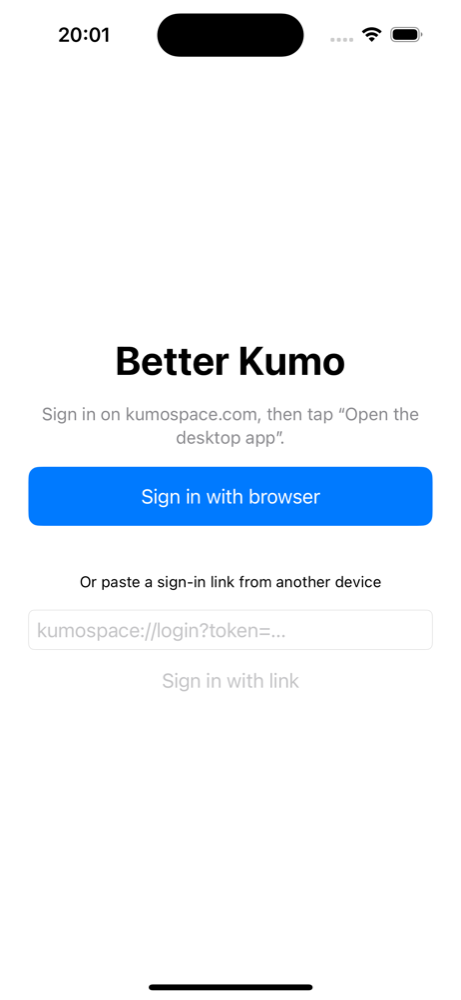

# Installing Better Kumo

The apps are called **Better Kumo** on phones and on the computer. Bundle IDs, package names and the Rust crates keep the
internal name *kumowatch*. This guide covers every piece end to end: building, installing the apps on real phones, and setting up the computer that
runs Kumospace desktop. The sections are written so you can follow them top to bottom on a clean machine.

## 1. What runs where

```
 Phone (Android / iPhone)                Computer with Kumospace desktop ("office computer")
 ┌──────────────────────────┐            ┌─────────────────────────────────────────────┐
 │ Better Kumo app          │            │ Kumospace.app  --remote-debugging-port=9222 │
 │  · chat, office, calls   │──Kumospace─┤        ▲ DevTools (localhost only)          │
 │    (talks to Kumospace,  │  cloud     │        │                                    │
 │     Sendbird, Daily      │            │ Better Kumo tray app (macOS/Windows/Linux)  │
 │     directly)            │            │  · starts and watches Kumospace             │
 │  · Desktop screen  ──────┼──HTTP──────┤  · relay on port 8787: map, move, status,   │
 │  · notifications         │ (Tailscale │    mic/camera, calls, notifications         │
 └──────────────────────────┘  or LAN)   └─────────────────────────────────────────────┘
```

- **The app alone** gives you chat, the office, people and calls. It needs no computer.
- **Better Kumo on the office computer** (macOS, Windows or Linux) adds two things:
  - **The *Desktop* screen**, which shows and controls the avatar of the desktop app.
  - **Notifications** for messages, @mentions, nudges, knocks, broadcasts, Public Chat, Nearby Chat and people joining your floor. You choose
    which ones for each of your statuses (§7).
- **Android** shows notifications itself by default (*This phone*), or through ntfy.
- **iPhone** gets them through ntfy (free), or through APNs with a paid Apple Developer account.
- The phone reaches the computer over the same Wi-Fi or, better, over **Tailscale**, which works from anywhere.

| Piece | Where | Needed for |
|---|---|---|
| Android app | Android phone, 8.0+, arm64 | everything on Android |
| iOS app | iPhone, iOS 17+ | everything on iPhone |
| Kumospace desktop | office computer | everything that Better Kumo adds |
| Better Kumo tray app (includes the relay) | office computer: macOS, Windows or Linux | Desktop screen, notifications from the office |
| Tailscale | office computer + phones | reaching the relay away from the office Wi-Fi |
| ntfy app | iPhone | iPhone notifications without a paid Apple account |

You only need a build machine to build the apps yourself; every release also has ready-made downloads for the
computer and for Android. The build machine and the office computer can be the same or two different ones.

## 2. Build machine (one-time)

| Build | macOS | Linux | Windows |
|---|---|---|---|
| iPhone app | ✅ (Apple Silicon, Xcode) | — | — |
| Android app | ✅ | ✅ | via WSL2 (the scripts are bash) |
| Better Kumo (tray app) | ✅ `scripts/build-desktop-macos.sh` | ✅ `cargo build --release -p kumo-desktop` | ✅ same, in PowerShell |

The commands below are for macOS. On Linux, install the Android SDK with Android Studio or the command-line tools,
JDK 17 from your package manager, and Rust from rustup.rs; the `rustup` and `cargo` lines are the same.

```sh
# Xcode from the App Store, then:
xcode-select --install
brew install xcodegen openjdk@17 android-commandlinetools   # or install Android Studio instead
brew install --cask android-platform-tools                   # adb

# Rust
curl --proto '=https' --tlsv1.2 -sSf https://sh.rustup.rs | sh
rustup target add aarch64-apple-ios aarch64-apple-ios-sim aarch64-linux-android armv7-linux-androideabi x86_64-linux-android
cargo install cargo-ndk

```

Install the Android SDK with Android Studio → Settings → Languages & Frameworks → Android SDK:
- SDK Platform **API 37**;
- Build-Tools **36.1+**;
- **NDK (Side by side)** 27.x. The build scripts pick the newest NDK they find.

- Gradle finds the SDK through `ANDROID_HOME`, which defaults to `~/Library/Android/sdk`.
- Or put `sdk.dir=/path/to/sdk` into `apps/android/local.properties`.
- Use JDK 17: `export JAVA_HOME=$(/usr/libexec/java_home -v 17)`.

Check the core:

```sh
cd core && cargo test
```

## 3. Android phone

### 3.0 Download instead of building

The **[latest release](https://github.com/IgorKravtsov/better-kumo-app/releases/latest)** has a signed
`Better-Kumo-Android-<version>.apk`. Open the release page on the phone, download the APK, tap it and allow installs
from the browser when Android asks. Then continue with §3.3. Build it yourself (below) only if you want your own
signing key.

### 3.1 Build the APK

```sh
scripts/build-android-release.sh
```

- **First run.** Creates a signing key in `~/.config/kumowatch/`: `android-release.jks` and
  `android-signing.properties`.
  - **Back up both files** (for example to a password manager).
  - Every update must be signed with the same key. Without it you have to uninstall the app, which loses the sign-in
    and settings, before a new build installs.
- **Output.** `dist/kumowatch-<version>-<build>.apk`, plus a copy at `dist/kumowatch-latest.apk`.
- **Architecture.** arm64 only, which covers every modern phone. Use `ABIS="arm64-v8a armeabi-v7a"` for an old
  32-bit phone.
- **Rebuilding.** `--skip-core` rebuilds the APK without recompiling Rust when only Kotlin changed.

The release app is `com.kravtsov.kumowatch` and is called "Better Kumo". Development builds
(`./gradlew :app:installDebug`) are `com.kravtsov.kumowatch.debug` and are called "Better Kumo Dev". Both can sit on the
same phone.

### 3.2 Install it

**Option A — USB cable** (fastest; also for updates):

1. On the phone, open Settings → About phone and tap *Build number* 7 times to turn on Developer options.
2. Settings → System → Developer options → *USB debugging*: on.
3. Connect the cable and accept the "Allow USB debugging?" prompt on the phone.
4. Run:

   ```sh
   adb devices                                  # the phone must show as "device"
   scripts/build-android-release.sh --install   # builds and installs on every connected device
   # or, for an existing APK:
   adb install -r dist/kumowatch-latest.apk
   ```

**Option B — Wireless adb** (Android 11+, phone and Mac on the same Wi-Fi):

1. Developer options → *Wireless debugging* → *Pair device with pairing code*.
2. Pair, using the address shown in the pairing dialog:

   ```sh
   adb pair <ip>:<pair-port>            # enter the 6-digit code
   ```

3. Connect, using the address on the Wireless debugging screen:

   ```sh
   adb connect <ip>:<port>
   adb install -r dist/kumowatch-latest.apk
   ```

**Option C — Send the file** (no developer options at all):

1. Send `dist/kumowatch-latest.apk` to the phone: Telegram "Saved messages", Google Drive, AirDrop-like apps,
   or a USB file copy.
2. Tap the file on the phone.
3. Android asks to allow installs from that app (Files, Telegram, …): allow it.
4. Google Play Protect may warn "unknown developer": choose *More details → Install anyway*.
5. To update later, install a newer APK the same way. Data is kept.

### 3.3 First launch on Android

1. Allow **notifications** when asked. They are needed for chat alerts and the relay.
2. Sign in (see §5).
3. For calls, allow **microphone** and **camera** on first use.
4. Turn off battery optimization so mirroring survives in the background: Settings → Apps → Better Kumo → Battery →
   *Unrestricted*. On Samsung, Xiaomi and similar phones, also see dontkillmyapp.com.
5. Add the **widget**: long-press the home screen → Widgets → Better Kumo.
   - Tapping it turns notifications on or off, for the delivery you chose (§7).
   - With *This phone* delivery and notifications on, a persistent "Kumospace alerts" notification shows that the
     app keeps its connection open.
6. Pair the phone with Better Kumo on the office computer (§6.3).

## 4. iPhone

There is no "APK" for iOS. Apple only runs apps that are signed for your device. The app is built on a Mac and
installed with Xcode tools.

### 4.1 Pick an Apple account

| | Free Apple ID ("Personal Team") | Paid Apple Developer Program ($99/year) |
|---|---|---|
| Install on your own iPhone | yes | yes |
| App keeps working | **7 days**, then rebuild and reinstall | 1 year; TestFlight builds 90 days |
| Push notifications (APNs) | no; use ntfy (§7.3) | yes |
| Home-screen widget | yes | yes |
| Share with other people | no (must be their Apple ID) | TestFlight, up to 10,000 testers |
| Install without a cable, updates over the air | no | TestFlight (§4.4) |

Everything else works the same on both: chat, office, calls, the Desktop screen, the widget and ntfy notifications.

### 4.2 One-time setup

1. Xcode → Settings → Accounts → **+** → Apple ID → sign in.
2. Note the **Team ID**. Xcode → Settings → Accounts → select the team → the ID is shown in brackets. It can also be
   found with:

   ```sh
   defaults read com.apple.dt.Xcode IDEProvisioningTeamByIdentifier | grep -E 'teamID|teamName|isFree'
   ```

3. Connect the iPhone by cable, unlock it and tap *Trust This Computer*.
4. On the iPhone, turn on Settings → Privacy & Security → **Developer Mode**. The phone restarts; confirm.
   The switch appears only after the phone has been connected to Xcode once. If you don't see it, open
   Xcode → Window → Devices and Simulators with the phone connected.
5. After the first pairing, the phone can be reached over Wi-Fi as well: Devices and Simulators →
   *Connect via network*.

### 4.3 Build and install

```sh
scripts/build-ios-device.sh --team <TEAM_ID>                 # free or paid team, base features
scripts/build-ios-device.sh --team <TEAM_ID> --full          # paid team: + Apple push notifications
```

The script:

1. builds the Rust core for iOS;
2. generates the Xcode project;
3. signs with automatic provisioning, which registers the device and the app IDs;
4. installs on the connected iPhone and starts the app.

Options:

- `--device <name|udid>` — choose the phone when several are connected (`xcrun devicectl list devices`).
- `--bundle-id <id>` — use a different bundle ID. This is needed if Apple says `com.kravtsov.kumowatch` is taken by
  another team. The widget and its shared keychain group follow it automatically.
- `--skip-core` — skip the Rust build when only Swift changed.
- `KUMO_TEAM=<TEAM_ID>` in the environment works instead of `--team`.

The first time a **free** team installs an app, iOS refuses to open it as an "Untrusted Developer". Fix it on the
iPhone: Settings → General → VPN & Device Management → your Apple ID → *Trust*.

**Free team, every 7 days:** re-run `scripts/build-ios-device.sh --team <TEAM_ID> --skip-core` with the phone
connected. Sign-in and data are kept.

**From Xcode instead of the script:**

1. Run:

   ```sh
   scripts/build-core-ios.sh
   cd apps/ios && xcodegen generate && open Kumowatch.xcodeproj
   ```

2. Select the *Kumowatch* target → Signing & Capabilities → choose your team. Do the same for the *KumowatchWidget*
   target.
3. Pick your iPhone as the run destination and press ⌘R.

`xcodegen generate` resets the team, so the script is the more convenient path.

### 4.4 TestFlight (paid team)

TestFlight is the easiest way to keep the app on your iPhones. No cable and no Developer Mode are needed. A build
works for 90 days, and new builds arrive as updates in the TestFlight app.

The team must be **your own** Apple Developer Program membership. Enroll at developer.apple.com/programs
($99/year, approval takes from a few hours to two days).

One-time setup:

1. **Register the App ID.** developer.apple.com → Certificates, IDs & Profiles → Identifiers → **+** → App IDs → App.
   - Bundle ID `com.kravtsov.kumowatch`.
   - Enable *Push Notifications*.
   - Repeat for `com.kravtsov.kumowatch.widget` (no extra capabilities).
   - The app and the widget share the relay settings through a keychain group (`<TEAM ID>.<bundle id>.shared`),
     which needs no registration.
   - The script can register these automatically, but doing it by hand avoids surprises.
2. **Create the app record.** App Store Connect (appstoreconnect.apple.com) → Apps → **+** → New App.
   - Platform iOS; bundle ID as above; SKU `kumowatch`.
   - Name: the store name must be unique across the App Store and must not look like someone else's trademark.
     If "Better Kumo" is taken, use another record name. The name under the icon stays "Better Kumo": it comes
     from the build, not from the record.
3. **Create an API key for uploads.** App Store Connect → Users and Access → Integrations → App Store Connect API
   → Team Keys → **+**, role *App Manager*.
   - Download `AuthKey_<KEYID>.p8`; it can be downloaded only once.
   - Note the *Issuer ID* shown above the key list.
4. **Write the local config.** Save the key as `~/.config/kumowatch/AuthKey_<KEYID>.p8` and create
   `~/.config/kumowatch/testflight.env`:

   ```sh
   KUMO_TEAM=<YOUR TEAM ID>
   ASC_KEY_ID=<KEYID>
   ASC_ISSUER_ID=<issuer uuid>
   ```

   Run `chmod 600` on both files.
5. **Add testers.** App Store Connect → the app → TestFlight → *Internal Testing* → **+** group → add yourself.
   - Internal testers must be users of your App Store Connect team; up to 100 of them.
   - Their builds need no Apple review.
   - External testers, by email or public link, need a short Beta App Review for the first build.

Every release:

```sh
scripts/build-ios-testflight.sh            # builds, signs for App Store, uploads
```

The script turns on push notifications and uses a timestamp as the build number. After 5–30 minutes of
processing, the build shows up in TestFlight. On the iPhone: install **TestFlight** from the App Store, accept the
invite, tap *Install*. Later builds update the same app, and sign-in is kept.

TestFlight builds use the **production** APNs environment, so set `sandbox = false` in the relay's `[apns]` section
(§7.3). Builds installed with `build-ios-device.sh` use `sandbox = true`.

### 4.5 First launch on iPhone

1. Allow notifications.
2. Sign in (§5).
3. Allow microphone and camera when joining a call for the first time.
4. Pair the phone with Better Kumo on the office computer (§6.3).
5. Set up ntfy for notifications (§7.2), unless APNs is set up.
6. Add the **widget**: long-press the home screen → **+** → Better Kumo. One tap turns notifications on or off without
   opening the app (§7.4).

## 5. Signing in on a phone



Two ways; use whichever is easier:

1. **Sign in with browser.** Opens the Kumospace web sign-in (Google works). When the page offers *Open the desktop
   app*, tap it: that returns to Better Kumo, signed in.
2. **Sign-in link from a computer that is already signed in.** No passwords at all:

   ```sh
   cargo install --path core/crates/kumo-cli --locked     # once; installs kumo-cli to ~/.cargo/bin
   kumo-cli login --from-desktop                           # takes the session of Kumospace desktop (debug port 9222)
   kumo-cli transfer-token --link                          # prints kumospace://login?token=…
   ```

   Then paste the link into *Or paste a sign-in link from another device*, or open it on the phone.
   - The token works once and expires in a few minutes.
   - Treat it like a password.

<br clear="right">

## 6. Office computer: Better Kumo

Do this on the computer (macOS, Windows or Linux) where Kumospace desktop runs and where you are signed in to it.

### 6.1 Install Better Kumo

Better Kumo is a small tray app (menu bar on macOS, notification area on Windows, system tray on Linux). It does
everything the computer side needs:

- **Kumospace with phone control.** Starts Kumospace desktop with a local debugging port. If Kumospace was opened
  without the port (from the Dock, Start menu or launcher), it restarts it: automatically when it was just opened,
  otherwise from the menu. If you close Kumospace, it opens it again, unless *Keep Kumospace open* is off in its menu.
- **Signs itself in.** Takes the sign-in from Kumospace desktop.
- **Runs the relay.** The relay is the small HTTP service (port 8787) that the phone talks to. It serves the Desktop
  screen, hands calls over and sends notifications.
- **Pairs phones by QR code.**

First **install Kumospace desktop** from kumospace.com, open it and sign in. Then install Better Kumo for your system.
Every build is on the **[latest release](https://github.com/IgorKravtsov/better-kumo-app/releases/latest)** page.

<details open>
<summary><b>macOS</b> (13+, Apple Silicon and Intel)</summary>

1. **Install it**, either way:
   - **With Homebrew** (easiest; updates with the rest of your apps):

     ```sh
     brew tap igorkravtsov/tap
     brew trust igorkravtsov/tap        # newer Homebrew asks you to trust third-party taps once
     brew install --cask better-kumo
     ```

     Update with `brew upgrade --cask better-kumo`.
   - **By hand:** download `Better-Kumo-macOS-<version>.zip`, unzip it and move `Better Kumo.app` to
     `/Applications`.
2. **Open it the first time.** The app is not notarized by Apple (no Developer ID).
   Right-click it → **Open** → **Open**. On newer macOS, open it once, then System Settings → Privacy & Security →
   **Open Anyway**. Or run `xattr -dr com.apple.quarantine "/Applications/Better Kumo.app"`.
3. **Start it.** A person icon appears in the menu bar. Kumospace restarts once so the phone can control it.
4. **Turn on *Start at login*** in its menu.
5. **Keep the Mac awake** while you rely on it: System Settings → Energy → *Prevent automatic sleeping when the
   display is off*.

To build it yourself instead (Rust is enough; Xcode and Android are not needed):

```sh
scripts/build-desktop-macos.sh          # → dist/Better Kumo.app and a zip next to it
```

</details>

<details>
<summary><b>Windows</b> (10/11, x64)</summary>

1. **Install Kumospace** with its Windows installer from kumospace.com. Better Kumo finds it in
   `%LOCALAPPDATA%\Programs\kumospace` or `Program Files\Kumospace`.
2. **Download and run** `Better-Kumo-Windows-x64-<version>-Setup.exe`. It installs for your user only, with no
   administrator prompt, into `%LOCALAPPDATA%\Programs\Better Kumo`, adds Better Kumo to the Start menu and starts it.
   The installer and the app are not signed, so SmartScreen may say *Windows protected your PC*: click
   **More info** → **Run anyway**. To update, run the newer installer: it stops Better Kumo (and `kumo-mcp` if an AI agent
   is running it), replaces it and keeps your settings.
3. *Without the installer:* download `Better-Kumo-Windows-x64-<version>.zip`, unzip it to a folder that stays, e.g.
   `%LOCALAPPDATA%\Programs\Better Kumo`, and start `Better Kumo.exe`. *Start at login* remembers this location.
4. A person icon appears in the notification area; click **^** next to the clock if it is hidden, and drag it out to
   keep it visible. Kumospace restarts once so the phone can control it.
5. **Allow the firewall prompt** for *private networks*, so the phone can reach the relay.
6. **Check that *Start at login*** is on in its menu (the installer turns it on unless you unticked it).
7. **Keep the PC awake:** Settings → System → Power → *Screen and sleep* → *When plugged in, put my device to sleep
   after*: **Never**.

To build it yourself: install Rust from rustup.rs (with the Visual Studio C++ build tools it asks for), then
`cargo build --release -p kumo-desktop` in `core\`. The program is `core\target\release\better-kumo.exe`.
`scripts/build-desktop-windows.sh` (Git Bash, with Inno Setup 6.5+: `winget install JRSoftware.InnoSetup`) builds the
installer and the zip into `dist\`.

</details>

<details>
<summary><b>Linux</b> (x64, a desktop with a system tray)</summary>

1. **Install Kumospace** as its AppImage from kumospace.com, e.g. into `~/Applications`. Better Kumo looks for
   `kumospace*.AppImage` in `~/Applications`, `~/Downloads` and your home folder, and for `/opt/Kumospace/kumospace`,
   `/usr/bin/kumospace` and `~/.local/bin/kumospace`. Elsewhere, set `KUMOSPACE_PATH=/path/to/Kumospace.AppImage`.
2. **Install Better Kumo**, one of three ways:
   - **APT** (Ubuntu, Debian, Mint, Pop!_OS; updates come with `sudo apt upgrade`):

     ```sh
     curl -fsSL https://igorkravtsov.github.io/better-kumo-app/apt/better-kumo.gpg \
       | sudo tee /usr/share/keyrings/better-kumo.gpg > /dev/null
     echo "deb [signed-by=/usr/share/keyrings/better-kumo.gpg] https://igorkravtsov.github.io/better-kumo-app/apt stable main" \
       | sudo tee /etc/apt/sources.list.d/better-kumo.list
     sudo apt update && sudo apt install better-kumo
     ```

     It installs `better-kumo` with its libraries and adds *Better Kumo* to the app menu.
   - **A `.deb` file:** download `better-kumo_<version>_amd64.deb` from the release, then
     `sudo apt install ./better-kumo_<version>_amd64.deb`. It doesn't update by itself.
   - **The tarball** (other distributions): install the libraries, then unpack the binary:

     ```sh
     sudo dnf install gtk3 libayatana-appindicator-gtk3 libxdo        # Fedora; on Debian-likes:
     # sudo apt install libgtk-3-0 libayatana-appindicator3-1 libxdo3
     tar -xzf Better-Kumo-Linux-x64-<version>.tar.gz
     mkdir -p ~/.local/bin && mv better-kumo-<version>/better-kumo ~/.local/bin/
     ```

   On GNOME, tray icons also need the *AppIndicator and KStatusNotifierItem Support* extension (preinstalled on
   Ubuntu).
3. **Start it** from the app menu (*Better Kumo*), or run `better-kumo &`.
4. A person icon appears in the tray. Kumospace restarts once so the phone can control it.
5. **Turn on *Start at login*** in its menu (it writes `~/.config/autostart/better-kumo.desktop`).
6. **Keep the computer awake** while you rely on it: Settings → Power → *Automatic Suspend*: off.

To build it yourself: `sudo apt install libgtk-3-dev libayatana-appindicator3-dev libxdo-dev`, install Rust from
rustup.rs, then `cargo build --release -p kumo-desktop` in `core/`. The program is `core/target/release/better-kumo`.

</details>

> Windows and Linux builds are new: they are built and checked by CI on every release, but have had little use so
> far. Please open an issue if something doesn't work.

The menu:

| Item | Meaning |
|---|---|
| **Kumospace: running** | `starting…`, `closed` (when *Keep Kumospace open* is off), `not installed`, or `opened without phone control` (then use *Restart Kumospace for phone control*) |
| **Phone control: desktop connected · 1 phone** | The relay sees Kumospace, and how many phones are paired. `phone is in the call` while the phone holds the call |
| **Pair a phone…** | Opens the pairing page (§6.3) |
| **Open Kumospace** | Brings Kumospace to the front |
| **Restart Kumospace for phone control** | Enabled when Kumospace runs without the debugging port |
| **Keep Kumospace open** | On (default): opens Kumospace again whenever it is closed. Off: a closed Kumospace stays closed; use *Open Kumospace*. Kumospace opened without phone control is still restarted once with it if it was just opened. Saved in `~/.config/kumowatch/better-kumo.json` |
| **Start at login** | Starts Better Kumo when you log in |
| **Open log** | Opens the log file (paths below) |
| **Quit Better Kumo** | If the phone holds the call, it gives the call back to the desktop first |

Where Better Kumo keeps its files (`~` is your home folder, `C:\Users\<you>` on Windows):

| | macOS | Windows | Linux |
|---|---|---|---|
| Settings (`relay.toml`, `better-kumo.json`) | `~/.config/kumowatch/` | `C:\Users\<you>\.config\kumowatch\` | `~/.config/kumowatch/` |
| Relay data (session, phones, notification settings) | `~/.local/share/kumowatch-relay/` | `C:\Users\<you>\.local\share\kumowatch-relay\` | `~/.local/share/kumowatch-relay/` |
| Log | `~/Library/Logs/kumowatch/better-kumo.log` | `…\kumowatch-relay\better-kumo.log` (relay data folder) | `~/.local/share/kumowatch-relay/better-kumo.log` |

A sleeping computer means no relay and no desktop presence.

### 6.2 Make the computer reachable from the phone

**Tailscale** (recommended; works on cellular and any Wi-Fi):

1. Install Tailscale on the computer (tailscale.com/download for macOS, Windows and Linux) and on each phone
   (App Store / Google Play).
2. Sign in to the same account everywhere.
3. Nothing else: the pairing page lists the computer's Tailscale address first.

**Same Wi-Fi only:** the pairing page also lists the computer's LAN address.
- Give the computer a fixed address in the router, or the link breaks when the address changes.
- The firewall may ask to allow incoming connections for Better Kumo (macOS, Windows): allow it on private
  networks. On Linux with `ufw`, run `sudo ufw allow 8787/tcp`.

### 6.3 Pair the phone

1. In the Better Kumo menu, choose **Pair a phone…**. A page opens with one QR code per address:

   

2. Scan the code:
   - **iPhone:** in Better Kumo, **Profile** (the person icon on the Office tab) → **Scan relay QR code**. The iPhone
     camera app works too.
   - **Android:** the camera app, or any QR scanner; it opens the link in Better Kumo.
3. The app says *Relay connected*.

The code contains the relay's secret. Do not share it or post a photo of it. To pair on a phone without a camera,
tap *Open link on this device* on the page and send that link to the phone privately.


After pairing, **Office → Your desktop** opens the **Desktop** screen:

- the live floor map of the desktop app, with rooms and people;
- tap the map to walk there, or pick a room or floor;
- follow someone; nudge people;
- set Available / Away / Focusing and a status message;
- switch the desktop's mic and camera;
- the house button takes the avatar home;
- **Use phone for audio and video** moves the desktop's call to the phone. When you leave, the desktop takes it
  back.

<br clear="right">

### 6.4 Advanced: the relay without the tray app

On a computer where you prefer a plain background service (or a server without a desktop), run `kumo-relay` on its own.
`scripts/install-relay.sh` sets it up as a launchd agent; on Linux or Windows run the same `kumo-relay` commands and
start `kumo-relay run` with your service manager (systemd user unit, Task Scheduler).
Only Rust is needed (`rustup`, §2).

```sh
git clone <this repo> ~/kumowatch && cd ~/kumowatch
cargo install --path core/crates/kumo-cli --locked

# Kumospace desktop with the debugging port (quit it first with ⌘Q):
open -a Kumospace --args --remote-debugging-port=9222
curl -s http://127.0.0.1:9222/json/version          # must print JSON

kumo-cli spaces                                     # find your space name
cargo run --release -p kumo-relay -- init --space <space>
kumo-cli login --from-desktop
kumo-cli transfer-token | cargo run --release -p kumo-relay -- login --token-stdin

scripts/install-relay.sh                            # ~/.local/bin/kumo-relay + launchd agent com.kumowatch.relay
kumo-relay pair --url http://<tailscale-or-lan-address>:8787   # prints the link to open on the phone
```

- `init` writes `~/.config/kumowatch/relay.toml` (mode 600): the listen address `0.0.0.0:8787`, a random `secret`
  for the phone, the space, ntfy and APNs settings, and `desktop_cdp`.
- `login` stores the relay's own Kumospace session in `~/.local/share/kumowatch-relay/`.
- Logs: `~/Library/Logs/kumowatch/relay.log`. Restart with
  `launchctl kickstart -k gui/$(id -u)/com.kumowatch.relay`; stop with `launchctl bootout gui/$(id -u)/com.kumowatch.relay`.
- Kumospace started from the Dock has no debugging port; start it with the `open` command above.
- Run either this service or the Better Kumo app, not both: they would fight over port 8787. Better Kumo reuses the
  same `relay.toml` and data, so paired phones keep working when you switch.

Test from the phone's browser: `http://<address>:8787/v1/status` must answer `401` (reachable, no secret yet).

### 6.5 Record and transcribe meetings (optional module)

Meetings are an optional part of Better Kumo: the app itself stays small, and the transcriber (Whisper) and its speech
model are downloaded only if you want them.

1. In the Better Kumo menu, choose **Settings…**. A page opens in your browser (`http://127.0.0.1:8787/settings`; it
   opens only on this computer).
2. Under **Meetings module**, click **Install**. Better Kumo downloads the transcriber for your computer from the
   GitHub release of your version (checked against its SHA-256) and the speech model (about 575 MB), into
   `~/.local/share/kumowatch-relay/`.
3. Record by hand or automatically, both on the page and in the menu:
   - **Start recording now** records from that moment until you click **Stop recording**, whoever is around.
   - **Start recording automatically**: once the same people stay in earshot for 5 seconds, Better Kumo records the
     conversation (from the moment that group formed). It stops 5 seconds after you are alone or after 3 minutes of
     silence. A conversation with less than 20 seconds of speech is thrown away, also when you stop it by hand. After you
     stop it by hand, it does not start again until the people around you change.

Each recording is transcribed on this computer when it ends. The menu shows what it is doing; **Open meetings folder**
opens `~/Documents/Better Kumo/Meetings/`, one folder per meeting with `transcript.md`.

When a recording starts, Better Kumo posts a short notice to Nearby Chat, so the people you're talking to know. Record
people only with their consent.

The settings page changes the times, the language, the speech model, the folder, whether the audio is kept and the
Nearby Chat notice; they are saved in the `[meetings]` section of `~/.config/kumowatch/relay.toml`. **Remove** deletes
the transcriber and the speech models; transcripts stay.

On a Mac, transcription uses the GPU (Metal). On Windows and Linux it runs on the CPU and takes longer; pick the
**Small** model if it is too slow.

**Development:** to use a transcriber you built yourself (`cargo build --release -p kumo-transcriber`), set it in
`relay.toml` and restart Better Kumo; the settings page never changes this path:

```toml
[meetings]
transcriber = "/path/to/core/target/release/better-kumo-transcriber"
```

### 6.6 Your Kumospace chat in Claude Code, Codex and other AI agents

`kumo-mcp` is an [MCP](https://modelcontextprotocol.io) server that gives an AI agent your Kumospace chat. The agent
can read direct messages, group DMs and channels with their threads, see the images people sent, and send messages
as you. Instead of copying a message into the agent, say *"take Kirill's last message and do what he asks"*.

It runs on the computer where the agent runs. It needs a Kumospace sign-in and nothing else (Better Kumo doesn't have
to be running).

**Install.** Better Kumo from a release already includes it:

| Install | `kumo-mcp` |
|---|---|
| Homebrew | on your `PATH` as `kumo-mcp` |
| macOS zip | `/Applications/Better Kumo.app/Contents/MacOS/kumo-mcp` |
| Windows installer | `%LOCALAPPDATA%\Programs\Better Kumo\kumo-mcp.exe` |
| Windows zip | `kumo-mcp.exe` next to `Better Kumo.exe` |
| APT, Linux tarball | `/usr/bin/kumo-mcp`, or next to `better-kumo` |
| From source | `scripts/install-mcp.sh` (builds it into `~/.local/bin/kumo-mcp`) |

**Sign in.** The first time it starts, it takes the sign-in from Kumospace desktop (started by Better Kumo, with the
debugging port) or, failing that, from Better Kumo's own session. To do it by hand: `kumo-mcp login`. Check with
`kumo-mcp check`: it prints who you are and how many conversations it sees.

**Add it to your agent:**

```sh
claude mcp add --scope user kumo -- kumo-mcp          # Claude Code
codex mcp add kumo -- kumo-mcp                        # Codex
scripts/install-mcp.sh --register                     # from source: build, install and add to both
```

For Claude Desktop, Cursor and other MCP clients, add a stdio server with the command `kumo-mcp` (the full path
from the table above when it isn't on `PATH`), for example in `claude_desktop_config.json`:

```json
{ "mcpServers": { "kumo": { "command": "/Applications/Better Kumo.app/Contents/MacOS/kumo-mcp" } } }
```

**Tools:**

| Tool | What it does |
|---|---|
| `whoami` | who you are signed in as, the space, the chat connection and the safety mode |
| `inbox` | unread conversations with their unread messages |
| `list_channels` | conversations, most recent first: unread counts, last message; filter by kind or name |
| `find_people` | a person's user id and your DM channel with them |
| `read_messages` | a conversation, fresh from the server; page back with `before_id`; `include_threads` and `include_images` |
| `read_thread` | a whole thread |
| `get_attachment` | the file of a message: images come back for the agent to see; every file is saved to `~/.local/share/kumowatch-mcp/attachments/` |
| `search_messages` | search what is synced to this computer by text, sender, conversation and time |
| `wait_for_events` | wait for messages and office events that match your rules (see below) |
| `send_message` | send as you: text (Markdown, `<@USER_ID>` mentions), a thread reply, local files |
| `react`, `mark_read`, `edit_message`, `delete_message` | the rest of what you can do with a message; edit and delete only your own |

Reading never marks anything as read.

**Watch for events while you are away.** `wait_for_events` waits for things that match any of several rules and
returns them, each with the names of the rules it matched. So one agent session can, for example, answer messages from
Amy, answer messages from Bo and tell you when Cy comes to the floor. A rule is *what* (any of `message`, `nudge`,
`knock`, `entered_room`, `left_room`, `joined_floor`, `online`, `offline`, `status`, `nearby_chat`), *from whom*
(user ids or names) and, for office events, *where* (rooms or floors); leave a part empty for "any".

- Save rules under *Watched events* on the Better Kumo settings page (stored in `~/.config/kumowatch/watch.json`), or
  pass `rules` in the call for one-off watching.
- Messages need only `kumo-mcp`. Office events come from Better Kumo, which sees them through the Kumospace desktop
  app, so both have to run on this computer; until they do, the tool says why office events are missing.
- The tool returns at once with what happened since its previous call in that session, otherwise waits up to
  `timeout_seconds` (default 600) and returns an empty list. Ask the agent to keep calling it.
- It only waits: whether the agent answers, and with your approval or not, is up to the agent session (see Safety).
  The session has to stay open; nothing happens once it ends.

**Turn it on or off.** The switch *AI agents can use my chat (MCP)* is in the Better Kumo menu on the computer and in the
phone app (You → Notifications relay; it appears once Better Kumo on the computer is updated to a version that has it).
Both show the same setting, stored in `~/.config/kumowatch/agents.json`. It is on until you turn it off; a damaged
file counts as off.

- When it is off, every `kumo-mcp` that uses this file disconnects from Kumospace within a couple of seconds and its
  tools answer that access is turned off. A request that was already on its way to Kumospace can still finish, and a
  `kumo-mcp` that is still connecting when you turn it off finishes connecting first, then disconnects at once.
- Turning it back on works at the next tool call, without restarting the agent.
- It is a convenience switch, not a security boundary. An agent that can run shell commands as you could edit the file
  itself, or start `kumo-mcp` with another `--agents-file`; the chat cache and downloaded attachments in
  `~/.local/share/kumowatch-mcp/` stay readable. To shut an agent out for sure, remove `kumo-mcp` from its MCP
  servers (see Uninstalling).

**Safety.** Messages are written by other people, and an agent that reads them can be talked into things. So:

- Keep the writing tools (`send_message`, `react`, `mark_read`, `edit_message`, `delete_message`) on *ask every time*
  in your agent, and check that it really asks: don't add them to an allow list or an auto-approve mode. They are
  marked as writing tools, but that mark is only a hint; your agent's approval settings decide whether it asks.
- `send_message` can attach any file this computer's user can read. Before approving a send, look at its `files`.
- `kumo-mcp --read-only` drops the writing tools altogether.
- `kumo-mcp --self-only` writes only to your own notes channel (your DM with yourself). Use it to try things out.

Pass the flag when adding it, e.g. `claude mcp add --scope user kumo -- kumo-mcp --read-only`.

**Options:** `--space <name>` (default: Better Kumo's space, then your default space), `--session <file>` (default
`~/.config/kumowatch/session.json`, shared with `kumo-cli`), `--db <file>` (chat cache; default
`~/.local/share/kumowatch-mcp/<space>-<user id>.db`), `--devtools-port <port>` (default 9222), `--watch-file <file>`
(default `~/.config/kumowatch/watch.json`).

**Agents on another computer.** Normally the agent starts `kumo-mcp` itself, so both run on the same computer. To give
agents on another computer on your network the chat of the office computer, run an HTTP server on the office computer:

```bash
kumo-mcp serve-http                      # listens on 0.0.0.0:8788, path /mcp
kumo-mcp token                           # prints the bearer token
```

The token is created on the first run in `~/.config/kumowatch/mcp-token`. On macOS and Linux only you can read it
(mode 600), and `kumo-mcp` refuses a token file other users can read; on Windows it is protected by your user
folder's permissions. On the other computer:

```bash
claude mcp add --scope user --transport http kumo http://office-mac.local:8788/mcp \
  --header "Authorization: Bearer <token>"                                         # Claude Code
export KUMO_MCP_TOKEN=<token>                                                      # Codex: in your shell profile
codex mcp add kumo --url http://office-mac.local:8788/mcp --bearer-token-env-var KUMO_MCP_TOKEN
```

- Every request needs the token; without it the server answers 401. Requests from a web page (with an `Origin`
  header) are refused, so a site open in a browser on your network can't use it.
- It is plain HTTP: anyone who can watch the network traffic can read the token and the chat. Use it on a network
  you trust, or over a VPN such as Tailscale, and listen only there: `--listen 100.x.y.z:8788` (the office
  computer's Tailscale address) or `--listen 127.0.0.1:8788` behind an SSH tunnel.
- New token: `kumo-mcp token --rotate`, then restart `serve-http` and update the agents. `--token-file <file>` keeps
  the token elsewhere.
- `--read-only` and `--self-only` work as above: `kumo-mcp --read-only serve-http`. The *AI agents can use my chat (MCP)*
  switch applies too.
- Over HTTP `send_message` can't attach files: the paths would be read on the office computer, not the agent's.
  `get_attachment` and `include_images` return images and text files but not where they were saved.
- One `serve-http` serves every agent that connects; keep it running (e.g. in a terminal or as a login item). Stop it
  with Ctrl-C. AI note settings (and their exceptions) apply to the next message without a restart.
- As a launchd agent in `~/Library/LaunchAgents` that runs `kumo-mcp` from `Better Kumo.app` (directly or through the
  Homebrew link), it is restarted on the new version after Better Kumo updates itself. To restart it by hand use
  `launchctl bootout gui/$(id -u)/<label>` and then `launchctl bootstrap gui/$(id -u) <plist>`: `kickstart -k` fails
  after an update (`OS_REASON_CODESIGNING`), because the app is signed ad hoc and launchd remembers the old signature.

**Background event watchers.** `GET /events` keeps a connection open and sends one JSON object per line
(`application/x-ndjson`), without a timeout. Run it under a line-oriented monitor to keep the agent's conversation free:

```bash
curl -sN -H "Authorization: Bearer $(cat ~/.config/kumowatch/mcp-token)" \
  'http://HOST:8788/events?people=<id>&kinds=message'
```

`people` (user ids or full names), `kinds` and `places` (room/floor ids or names) are comma-separated;
`label` names the rule. URL-encode names containing spaces or special characters; a name cannot contain a comma.
The parameters describe one rule, and as in `wait_for_events` a missing or empty filter means "any": `?people=` or
`?label=x` alone matches every message and office event, so make the shell fail on an unset variable (for example `people=${AMY:?}`). Unknown parameters
are rejected with 400. Without parameters the stream uses the saved **Watched events** rules, re-read while watching,
and answers 400 if none exist.
Each stream starts with new events and has its own cursors, so it can run alongside MCP sessions and other watchers.
Event objects have the same shape as the entries in `wait_for_events.events`, including `kind` and matched `rules`.
After 60 seconds without a line the stream sends `{"kind":"heartbeat"}`. Notes such as
`{"kind":"note","text":"…"}` report when office events become unavailable (again after each recovery), when the office position could not be
taken at connect time, and, ahead of the events that follow, how many earlier events a reader that fell behind could no
longer check. `{"kind":"error","text":"…"}` ends the stream: when AI-agent access is turned off,
when the saved rules become empty, or when chat cannot connect. With AI-agent access already off the request gets 403.
Server shutdown closes the stream too. Delivery is at most once: events between a disconnect and the next request are
not replayed, so a watcher that reconnects (with a short backoff) should expect a gap.
The same bearer token and browser-origin restrictions as `/mcp` apply.

## 7. Notifications

### 7.1 Choose what reaches you


**Profile → Notifications relay** (iPhone), or **Profile → Notifications** (Android):

- **Notifications.** The main switch. The home screen widget flips this same switch. The Better Kumo menu has no switch:
  the Mac always sends, the phone decides.
- **Status picker.** *Available*, *Away*, *Focusing*, *Unknown*. Every status has its own set of switches. *Now:*
  shows which one applies right now.
  - *Unknown* applies when the desktop app isn't running, or you are idle or offline.
- **All for &lt;status&gt;.** Turns every kind on or off for that status in one tap.
- **The kinds:** Messages, @Mentions, Nudges, Knocks, Broadcasts, Public Chat, Nearby Chat, Joined the Floor.
  - *Joined the Floor* (someone enters the floor you are on) is off unless you turn it on; every other kind starts on.
  - Nudges, Knocks, Broadcasts, Public Chat, Nearby Chat and Joined the Floor come from the desktop app, so Better
    Kumo must be running on the office computer.
  - A Broadcast you are already watching on the computer (you're Available or Focusing and its window is on screen)
    raises no notification.

<br clear="right">

### 7.2 Delivery and ntfy


**Delivery** decides how notifications reach the phone:

| | iPhone | Android |
|---|---|---|
| **This phone** | not possible yet | **default**: the app keeps its own connection and shows notifications itself |
| **ntfy** | **always** | optional |

**Set up ntfy:**

1. Install **ntfy** (App Store / Google Play) and allow its notifications.
2. In Better Kumo, type a topic into **ntfy topic** and tap **Save**.
   - Pick something hard to guess, like `kumo-alex-7f3k2`. Anyone who knows the topic can read it.
   - The topic starts empty. Nothing is sent until you set one.
3. In ntfy, tap **+** and subscribe to the same topic on `https://ntfy.sh`. Or tap **Open topic in ntfy** in
   Better Kumo.
4. Tap **Send test notification**.

Tapping a notification opens the chat in Better Kumo. Clearing the topic and saving turns ntfy off.

<br clear="right">

### 7.3 APNs (paid Apple team, iPhone)

Native push notifications without the ntfy app:

1. Go to developer.apple.com → Certificates, IDs & Profiles → **Keys** → **+** → enable *Apple Push Notifications
   service* → download `AuthKey_<KEYID>.p8`. It can be downloaded only once.
2. Put it on the office computer, e.g. `~/.config/kumowatch/AuthKey_<KEYID>.p8`, and run `chmod 600` on it.
3. Add to `~/.config/kumowatch/relay.toml`:

   ```toml
   [apns]
   team_id = "<TEAM ID>"
   key_id = "<KEY ID>"
   key_path = "/Users/<you>/.config/kumowatch/AuthKey_<KEY ID>.p8"
   topic = "com.kravtsov.kumowatch"       # the bundle id used in §4.3
   sandbox = true                          # true for Xcode/script builds, false for TestFlight/App Store
   ```

4. Quit and reopen Better Kumo. Install the app with `--full` (§4.3) or from TestFlight (§4.4), open it and pair.
   The app registers its push token with the relay automatically.

### 7.4 Home screen widget

One tap turns notifications on or off without opening the app. Indigo with a bell means on; grey with a crossed-out
bell means off.

- **iPhone:** long-press the home screen → **+** → *Better Kumo* → add the small widget. Open the app once after
  pairing, so the widget gets the relay settings. The widget checks the relay every 15 minutes. It says
  *Relay unreachable* when the phone can't reach the computer (Tailscale off, computer asleep).
- **Android:** long-press the home screen → *Widgets* → *Better Kumo*, or Profile → *Add toggle widget to home
  screen*. It switches the delivery you chose: the phone's own notifications or ntfy.

## 8. Updating

| What changed | Run |
|---|---|
| New release | Download the new APK / zip from the [latest release](https://github.com/IgorKravtsov/better-kumo-app/releases/latest) and install it over the old one |
| Rust core or Android code | `git pull && scripts/build-android-release.sh --install` (or send the new APK) |
| Rust core or iOS code | `git pull && scripts/build-ios-device.sh --team <TEAM_ID> [--full]` |
| Better Kumo from a release (macOS, Windows x64, Linux x64) | **Update to … and restart** in its menu (see below) |
| Better Kumo, Homebrew | **Update in Terminal** in its menu, or `brew upgrade --cask better-kumo`, then start it again |
| Better Kumo, APT | **Update in Terminal** in its menu, or `sudo apt update && sudo apt upgrade`, then start it again |
| Better Kumo, by hand | Quit it, replace the app with the one from the new release (or your own build), start it again |
| Relay as a service (§6.4) | `git pull && scripts/install-relay.sh` (on the office Mac) |
| `kumo-mcp` from source (§6.6) | `git pull && scripts/install-mcp.sh` |
| iOS via TestFlight | `git pull && scripts/build-ios-testflight.sh`, then update in the TestFlight app |
| Free iOS team, 7 days passed | `scripts/build-ios-device.sh --team <TEAM_ID> --skip-core` |

Updates keep sign-in, chat cache and settings on all platforms.

**In-app updates.** Better Kumo looks for a new release shortly after it starts and then a few times a day; **Check for updates** in its menu looks right away. When there is one, the menu shows **Update to 0.x.y and restart**: Better Kumo downloads the file for your computer, checks its minisign signature against the release key built into the app (`packaging/release-minisign.pub`), puts the new version in place and starts it again.

- **Automatic updates**: turn on **Install updates automatically** in the menu or in Settings → Updates (off by default). Better Kumo then installs a new version as soon as it finds one while no meeting is being recorded or transcribed, no speech model is downloading and your phone is not in the call (with Kumospace closed it counts as free), and restarts. If one of those starts during the download, it waits until it ends before restarting; click the menu item to restart now, which also brings a call on the phone back to the computer. If an automatic install fails, it is not retried for that version: the menu offers **try again**. Turning the switch off does not stop a download already running. After an unattended update on macOS the next recording may ask for the microphone again. Installs from APT do not offer it, because the update would open a password prompt unasked: they update with `apt upgrade` or **Update in Terminal**. A build made with `scripts/build-desktop-macos.sh` counts as a release install and is replaced by the release.
- **macOS**: it replaces `Better Kumo.app` where it is, so that folder must be writable (it is for `/Applications` on an admin account), and the app must not run straight from the downloaded zip (move it to Applications first). There is no "Open Anyway" step this time, because the app downloaded the file itself, not a browser. If macOS asks, allow Better Kumo under System Settings → Privacy & Security → App Management. The app has no Apple certificate, so macOS may ask again for permissions such as the microphone after an update.
- **Windows**: it replaces `Better Kumo.exe` and `kumo-mcp.exe` in their folder; the old files are cleaned up by a later start once they are a day old.
- **Linux, APT**: it installs the `.deb` with `apt-get`, asking for your password in a system prompt.
- **Homebrew and APT** also get **Update in Terminal**, which opens a terminal running the package manager command and restarts Better Kumo if that installed a newer version. Right after a release the repository may not have it yet; the terminal then says so. With Homebrew, macOS may ask for "Open Anyway" again after a terminal update, because Homebrew marks its downloads as from the internet. The in-app button and automatic updates work too: the cask is marked `auto_updates`, so a plain `brew upgrade` updates Better Kumo only when it is behind and leaves alone a copy that already updated itself.
- Other computers (a build from source, ARM Linux or Windows) get a link to the release page instead.

## 9. Uninstalling

- **Android:** long-press the app → Uninstall, or run `adb uninstall com.kravtsov.kumowatch`.
- **iPhone:** long-press the app → Remove App.
- **Better Kumo from Homebrew:** turn off *Start at login*, quit it, then `brew uninstall --cask --zap better-kumo`.
- **Better Kumo from APT:** turn off *Start at login*, quit it, then `sudo apt remove better-kumo`; also
  `sudo rm /etc/apt/sources.list.d/better-kumo.list /usr/share/keyrings/better-kumo.gpg` to drop the repository.
- **Better Kumo from the Windows installer:** Settings → Apps → Installed apps → *Better Kumo* → Uninstall. It stops
  the app and removes its login entry; your settings and relay data stay (§6.1 lists the folders, delete them too for
  a clean slate).
- **Better Kumo installed by hand:** turn off *Start at login*, quit it and delete the app (`/Applications/Better Kumo.app`, the
  Windows folder, or `~/.local/bin/better-kumo`). Then delete its files: `~/.local/share/kumowatch-relay`,
  `~/.config/kumowatch/relay.toml` and, on macOS, `~/Library/Logs/kumowatch` (§6.1 lists the Windows paths).
- **Relay service without the tray app (§6.4):**

  ```sh
  launchctl bootout gui/$(id -u)/com.kumowatch.relay; rm ~/Library/LaunchAgents/com.kumowatch.relay.plist
  rm ~/Library/LaunchAgents/com.kumowatch.kumospace.plist
  rm -rf ~/.local/bin/kumo-relay ~/.local/share/kumowatch-relay ~/.config/kumowatch/relay.toml
  ```

  Keep `~/.config/kumowatch/android-release.jks` if you will build Android updates again.
- **kumo-mcp (§6.6):** `claude mcp remove --scope user kumo; codex mcp remove kumo`, then
  `rm -rf ~/.local/share/kumowatch-mcp ~/.config/kumowatch/mcp-token` (and `~/.local/bin/kumo-mcp` when built from
  source).

## 10. Troubleshooting

| Symptom | Cause / fix |
|---|---|
| Android: "App not installed" / "package conflicts" | The installed copy is signed with another key (e.g. an old debug build with the same ID). Uninstall it once, then install. |
| Android: no notifications in background | Battery optimization (§3.3 step 4); notification permission; notifications switched off (§7.1); the kind is off for your current status. |
| iPhone: no notifications | ntfy topic empty or not subscribed in the ntfy app (§7.2); the main switch or the kind is off for your current status (§7.1). Tap *Send test notification*. |
| iPhone widget: "Pair a relay in the app" | Open Better Kumo once after pairing so the widget gets the relay settings; then remove and re-add the widget. |
| iPhone widget: "Relay unreachable" | The phone can't reach the office computer: Tailscale off, the computer asleep, or Better Kumo not running. |
| Windows: no tray icon | It is hidden: click **^** next to the clock. Check Task Manager that `Better Kumo.exe` runs. |
| Linux: no tray icon | The desktop has no tray: on GNOME enable the *AppIndicator* extension; install `libayatana-appindicator3-1`. Run `better-kumo --foreground` in a terminal to see errors. |
| "Kumospace: not installed" (Windows, Linux) | Kumospace is in a place Better Kumo doesn't look: set `KUMOSPACE_PATH` to the Kumospace program or AppImage (§6.1). |
| iPhone: "Untrusted Developer" | Settings → General → VPN & Device Management → Trust. |
| iPhone: app stops opening after a week | Free team expiry, re-run the iOS script. |
| `build-ios-device.sh`: "No profiles for … were found" / "bundle identifier is not available" | Sign in to Xcode → Settings → Accounts. Use `--bundle-id com.<yourname>.kumowatch`. |
| `build-ios-device.sh`: "No iPhone found" | Connect and unlock the phone; trust the Mac; check `xcrun devicectl list devices`. |
| Desktop screen: "Kumospace desktop is not connected" | Kumospace runs without the debugging port: Better Kumo menu → *Restart Kumospace for phone control* (§6.1). With the plain relay (§6.4): restart Kumospace with `--remote-debugging-port=9222`, or check `desktop_cdp` in `relay.toml`. |
| Desktop screen: connection timeout / "failed to connect" | Wrong URL or the computer is asleep, off Tailscale, or the firewall blocks it. Open `http://<address>:8787/v1/status` on the phone. |
| Phone: "Better Kumo on the computer is older than this app" / a notification switch flips back | The relay runs an older Better Kumo. Update it on the computer the phone is paired with (the *Relay* address in the app), then restart it. |
| Desktop screen: "Wrong relay secret" | The secret changed (new `init`). Pair again: Better Kumo → *Pair a phone…*. |
| Call from phone: "exp-token" / drops after a while | Fixed automatically: the app asks the desktop for a fresh Daily token. If it repeats, restart Kumospace desktop. |
| Better Kumo menu: "Problem: …" | Open the log from the menu. Sign-in problems usually mean Kumospace desktop is signed out: sign in there and restart Better Kumo. |
| Relay log (§6.4): "not signed in" / 401 from Kumospace | `kumo-cli login --from-desktop && kumo-cli transfer-token \| kumo-relay login --token-stdin`, then restart the relay. |
| Sign-in link says expired | Tokens live a few minutes and work once. Create a new one. |
| AI agent: "not signed in to Kumospace" (kumo-mcp) | Start Kumospace desktop through Better Kumo, then `kumo-mcp login`. `kumo-mcp check` must print your name. |
| AI agent: "Access for AI agents is turned off" | Turn on *AI agents can use my chat (MCP)* in the Better Kumo menu or the phone app (§6.6). |
| AI agent: "runs with --self-only" | The server was added with `--self-only`; add it again without the flag to write to others (§6.6). |
| AI agent on another computer: 401 or can't connect (kumo-mcp serve-http) | Check that `serve-http` runs on the office computer and the agent sends `kumo-mcp token`'s current value; allow incoming connections for `kumo-mcp` in the macOS firewall (§6.6). |
| Duplicate notifications | Android with *This phone* while also subscribed to the topic in ntfy: unsubscribe there. Or two relays run (Better Kumo and the §6.4 service, or the old Node watcher `com.kumowatch.service`): keep one. |

## 11. Files and secrets

| File | Contents | Where |
|---|---|---|
| `~/.config/kumowatch/android-release.jks`, `android-signing.properties` | Android signing key and its password | build machine; **back up** |
| `~/.config/kumowatch/release-minisign.key` | key that signs release files for in-app updates (GitHub secret `MINISIGN_SECRET_KEY`; its public half is `packaging/release-minisign.pub`). Without it no app can update itself again | maintainer's machine; **back up** |
| `~/.config/kumowatch/apt-signing-private.asc` | key that signs the APT repository (its public half is published with it) | maintainer's machine; **back up** |
| `~/.config/kumowatch/relay.toml` | relay secret, ntfy topic, APNs config | office computer |
| `~/.config/kumowatch/AuthKey_*.p8` | APNs key (office computer); App Store Connect upload key (build machine) | office computer / build machine |
| `~/.config/kumowatch/testflight.env` | team ID and App Store Connect key IDs | build machine |
| `~/.local/share/kumowatch-relay/` | relay's Kumospace session, registered devices, notification settings, meetings module and speech models | office computer |
| `~/Documents/Better Kumo/Meetings/` | meeting transcripts (and audio with `keep_audio`) | office computer |
| `~/.config/kumowatch/session.json` | kumo-cli and kumo-mcp session | wherever kumo-cli or kumo-mcp runs |
| `~/.local/share/kumowatch-mcp/` | kumo-mcp chat cache and downloaded attachments | wherever kumo-mcp runs |
| `~/.config/kumowatch/mcp-token` | bearer token of `kumo-mcp serve-http` | office computer |
| `~/.config/kumowatch/auto-update.json` | the *Install updates automatically* switch (Better Kumo menu, Settings page) | office computer |
| `~/.config/kumowatch/agents.json` | the *AI agents can use my chat (MCP)* switch (Better Kumo menu, phone app, kumo-mcp) | office computer |
| Phone | session in Keystore (Android) / Keychain (iOS); relay URL and secret (iOS: shared with the widget through the keychain) | phone |

None of these are in git. Never commit them or paste them into chats.
